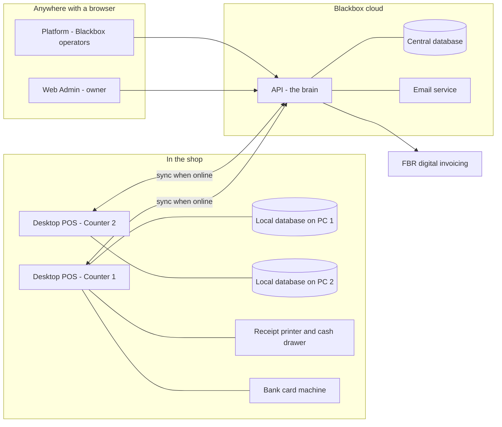
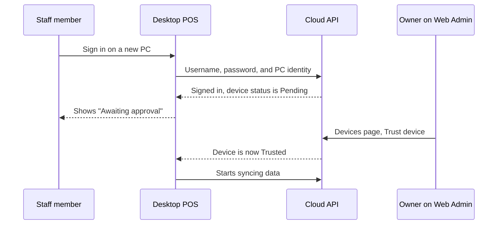
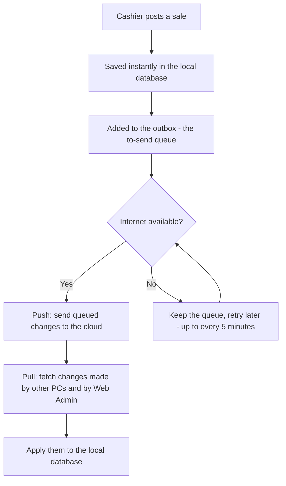
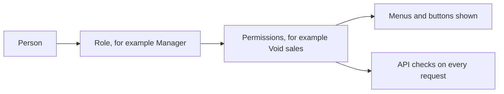
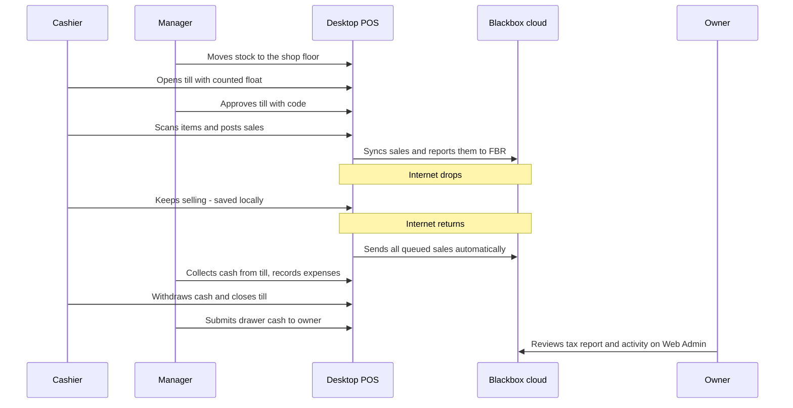

# Blackbox Product Guide

A plain-language guide to what Blackbox is, what it is made of, and how each part works.
Written for owners, managers, accountants, sales and support staff — no programming knowledge needed.

> Developers: the technical references are listed at the end in [For developers](#10-for-developers).

---

## Contents

1. [What Blackbox is](#1-what-blackbox-is)
2. [Glossary (words used in this guide)](#2-glossary)
3. [The four apps at a glance](#3-the-four-apps-at-a-glance)
4. [Complete architecture](#4-complete-architecture)
5. [Modules in each app](#5-modules-in-each-app)
6. [How each module works (UX walkthroughs)](#6-how-each-module-works-ux-walkthroughs)
7. [Roles and what they can do](#7-roles-and-what-they-can-do)
8. [Requirements of the SaaS](#8-requirements-of-the-saas)
9. [A typical day in the store](#9-a-typical-day-in-the-store)
10. [For developers](#10-for-developers)

---

## 1. What Blackbox is

Blackbox is a **retail store management system sold as a service (SaaS)**. Many different
businesses use the same Blackbox system, but each business only ever sees its own data.

It covers the full daily life of a shop:

- **Selling** at the counter (point of sale, or POS), including receipts, returns, and refunds.
- **Stock** — products, barcodes, warehouses, and moving goods from the store room to the shop floor.
- **Purchasing** — ordering from suppliers, receiving goods, and tracking what is owed to them.
- **Cash control** — cashier tills, manager cash drawers, expenses, bank deposits, and the owner's cash.
- **Tax** — Pakistan FBR digital invoicing on sales, and tax reports for the accountant.
- **People and security** — staff accounts, roles, approved computers, and a full activity history.

The most important design idea: **the shop keeps working even when the internet goes down.**
The counter computer stores everything locally and catches up with the cloud when the
connection returns.

---

## 2. Glossary

| Word | What it means here |
|------|--------------------|
| **Tenant** | One business account in Blackbox (for example, "Ali Mart"). All its data is kept separate from every other business. |
| **Operator** | The Blackbox company team that sets up and manages tenants. |
| **User** | A person who signs in: owner, manager, cashier, and so on. |
| **Role** | A job title that bundles permissions, such as "Cashier" or "Manager". |
| **Permission** | One specific thing a person is allowed to do, such as "post a sale" or "view tax reports". |
| **Device** | A specific counter or back-office computer running the desktop app. |
| **Trusted device** | A device the owner has approved. Only trusted devices may exchange data with the cloud. |
| **Cloud** | Blackbox's central server and database on the internet. It holds the master copy of all data. |
| **Offline-first** | The desktop app works on its own local copy first, then shares changes with the cloud later. |
| **Sync** | The automatic two-way exchange of changes between a device and the cloud. |
| **Till** | A cashier's cash session for a shift: it opens with a counted float and closes at the end. |
| **Float / opening balance** | The cash placed in a till at the start of a shift so the cashier can give change. |
| **Manager drawer** | The manager's own cash box. It funds tills, pays expenses, and receives cash collected from tills. |
| **Product / SKU** | A product is an item ("Pepsi"). A SKU is one sellable version of it ("Pepsi 500 ml"), with its own barcode and price. |
| **Warehouse** | A stock location (store room, branch, and so on). |
| **Inventory Out** | Moving stock from the warehouse to the shop floor so cashiers can sell it. |
| **Purchase Order (PO)** | An order sent to a supplier (vendor). |
| **Goods Receipt / Purchase Voucher (GRN)** | The record of goods actually received against a purchase order. |
| **Vendor** | A supplier the shop buys from. |
| **FOC** | "Free of charge": free units given to a customer, for example in a promotion. |
| **FBR** | Federal Board of Revenue (Pakistan). Blackbox can report each sale to FBR's digital invoicing system. |
| **HS code** | The product classification code FBR requires on invoices. |
| **Authentication code (TOTP)** | A 6-digit code from a phone authenticator app that a manager types in to approve sensitive actions. |
| **Soft delete** | "Deleted" records are hidden from lists, but kept for history and reports. |

---

## 3. The four apps at a glance

Blackbox is made of **four apps** that work together, plus two shared building blocks.

| App | Who uses it | Where it runs | In one sentence |
|-----|-------------|---------------|-----------------|
| **API** (`apps/api`) | Nobody directly. The other apps talk to it. | Cloud server | The "brain" and the master record keeper. It checks every request and stores all data. |
| **Web Admin** (`apps/web`) | Business owner | Any web browser | The owner's back office: staff, roles, devices, settings, and reports. |
| **Platform** (`apps/platform`) | Blackbox operator team | Web browser (internal) | The control room where Blackbox creates and manages client businesses. |
| **Desktop POS** (`apps/desktop`) | Cashiers, managers, warehouse staff (and the owner) | Windows or Linux PC in the shop | The in-store app for selling, stock, purchasing, and cash. Works offline. |

**Shared building blocks** (not separate apps):

- **Shared UI kit** (`packages/ui`): one set of buttons, forms, dialogs, and menus, so Web Admin and Desktop look and feel the same.
- **Shared rules** (`packages/shared`): one list of permissions, roles, tax and cash formulas, and validation rules, so every app follows exactly the same business rules.

---

## 4. Complete architecture

### 4.1 The big picture

How to read it:

- **The cloud is the hub.** Every app talks only to the API. Shop computers never talk to each other directly. They share data through the cloud.
- **Each shop computer has its own local database**, so selling continues when the internet drops.
- **The central database** (hosted on Supabase, a managed PostgreSQL service) holds the master copy of every business's data.
- **Email** is used for owner password-reset codes.
- **FBR** receives each eligible sale invoice when the business has FBR enabled.

### 4.2 Signing in and approving a new computer

Staff sign in with their **email or username** and a password. Passwords are stored in
scrambled form (hashed) and can never be read back. A sign-in lasts 15 minutes at a time
and renews automatically in the background for up to 7 days.

A new shop computer is **not trusted automatically**. The owner must approve it.

Extra protections:

- **One desktop session per person.** If a cashier is already signed in on another PC, they must sign out there first.
- **Revoking a device** signs it out immediately. On its next contact it is told to **erase its local data** before it can be used again.
- **Owners can reset a forgotten password** themselves with a 6-digit code sent by email.

### 4.3 How offline sync works

In plain words:

1. **Every change is saved locally first.** The cashier never waits for the internet.
2. **Changes queue up in an "outbox".** Queued changes are **never thrown away**, however long the internet is down.
3. When online, the device **pushes** its changes to the cloud, then **pulls** changes made elsewhere: another counter, or the owner on Web Admin.
4. Data travels in four **streams**:
   - **Master data:** products, brands, vendors, and similar records.
   - **Inventory:** stock movements.
   - **Purchasing:** documents such as purchase orders, goods receipts, and sales.
   - **Account snapshot:** reserved for future use.
5. If two places edit the same record, the **latest version wins**, and conflicts are flagged so they can be reviewed.
6. Only **trusted devices** belonging to users with the sync permission can sync.

### 4.4 Keeping each business's data separate

Every record in the database is stamped with the business (tenant) it belongs to. When
someone signs in, their business identity is sealed inside their sign-in token. The API
**always** uses that sealed identity to filter data, and never trusts a business ID typed in
or sent by the screen. One business can therefore never see another business's data.

### 4.5 What decides what a person can see and do

Screens hide what you cannot use, but the **real lock is in the API**: even if a hidden
screen were opened, the API refuses the action.

### 4.6 Hosting and updates

- **Cloud API and database:** hosted online. The database is managed by Supabase (PostgreSQL).
- **Desktop installers** for Windows and Linux are built automatically by GitHub Actions.
- **Desktop auto-update:** the shop app checks for and installs new versions quietly in the background.

---

## 5. Modules in each app

### 5.1 API (the cloud brain)

| Area | Modules |
|------|---------|
| Accounts and security | Auth (sign-in, password reset), Users, Roles, Permissions, Devices, Tenants (business settings), Activity log, Mail |
| Operator control | Platform (tenants and global roles) |
| Selling | Sales, Sale returns, Tills, FBR digital invoicing |
| Money | Cash flow (drawers, expenses, bank deposits, owner cash), Tax reports |
| Stock and purchasing | Brands, Categories, Units, Products, SKUs, Warehouses, Vendors and vendor groups, Purchase orders, Goods receipts, Vendor returns, Inventory out, Inventory out returns, Stock movements, Inventory reports, Dashboard, Data import (CSV) |
| Sync | Push, pull, status, full re-sync, conflict acknowledgement |

### 5.2 Web Admin (owner's back office)

| Module | Page |
|--------|------|
| Sign in / create business | `/` |
| Onboarding (welcome, business details, first location) | `/onboarding` |
| Dashboard | `/app` |
| Users (staff) | `/app/users` |
| Roles | `/app/roles` |
| Permissions catalog | `/app/permissions` |
| Devices (approve, revoke, delete) | `/app/devices` |
| Warehouses | `/app/warehouses` |
| Inventory in/out report | `/app/inventory/reports` |
| Tax report | `/app/reports/taxes` |
| Activity log | `/app/activity` |
| Business settings (taxes, FBR, approvals) | `/app/settings` |

### 5.3 Platform (Blackbox operator console)

| Module | What it does |
|--------|--------------|
| Operator sign-in | Separate sign-in, only for the Blackbox team |
| Tenants | List all businesses, create a new business with its owner account, activate or deactivate it, reset the owner's password |
| Global roles | View and edit the standard roles and their permissions, shared by every business |

### 5.4 Desktop POS (in-store app)

| Menu | Modules |
|------|---------|
| Dashboard | Summary cards, Sync button, Upload old data (CSV import) |
| Sale / Sales | New sale, Held bills, Past sales, Sale detail and receipt, Returns and refund vouchers, Till, Manager stock overview |
| Cash flow | Manager drawers, cash collections, expenses, bank deposits, owner cash |
| Inventory | Add/see products, SKU profile, Brands, Categories, Inventory Out, Out Returns, Vendor Returns, In/Out report |
| Purchasing | Create purchase order, Purchase orders, Receive goods, Purchase vouchers |
| Vendors | Add/see vendors, Vendor payments and ledger, Vendor groups |
| Warehouses | Warehouse list and edit |
| Activity | Activity log |
| Tax report | Tax summary (needs internet) |
| Hardware | Thermal receipt printer, cash drawer, bank card terminal |

Each person sees **only the menus their role allows**. For example, a cashier sees only Dashboard and Sale.

---

## 6. How each module works (UX walkthroughs)

Each walkthrough gives the **purpose**, **who** uses it, and a short **story**.

### Web Admin

**Create a business and onboarding**
- *Purpose:* Start using Blackbox.
- *Who:* New owner (or the Blackbox team via Platform).
- *Story:* The owner signs up with a business name, their name, email, username, and password. A short onboarding asks for business information (name, type, currency) and the first location (address, city, country, phone). This address appears on printed receipts.

**Dashboard**
- *Purpose:* The landing page after sign-in, with quick links to each section.

**Users (staff)**
- *Who:* Owner.
- *Story:* The owner clicks **Add user**, enters the name, username/email, and starting password, and picks a role (for example, Cashier). The new cashier can sign in straight away. Staff who leave are **deactivated**: they can no longer sign in, but their history stays.

**Roles and Permissions**
- *Purpose:* See and adjust which permissions each role grants.
- *Story:* The owner opens a role, ticks or unticks permissions, and saves. The **Permissions** page lists every permission that exists, with a description. The standard roles are shared across all businesses and are also managed by the Blackbox team (see Platform).

**Devices**
- *Who:* Owner.
- *Story:* A new counter PC appears as **Pending**. The owner opens it and clicks **Trust device**, and the PC starts syncing. If a PC is stolen or replaced, the owner clicks **Revoke**: it is signed out, and its local data is wiped before it can be reused.

**Warehouses**
- *Story:* Add or edit the business's stock locations.

**Inventory in/out report**
- *Story:* Pick a date range and see all stock coming in (goods received, returns from the shop floor) and going out (moved to the floor), with daily totals. It can be exported as CSV.

**Tax report**
- *Who:* Owner and accountant.
- *Story:* Pick dates and, optionally, a vendor. The report shows:
  - **Tax paid to vendors** on goods received (GST, sales tax, advance tax, and vendor credits such as incentives and shelf rent).
  - **Tax collected from customers** on sales, minus returns. Voided sales are excluded.

  It can be exported as CSV.

**Activity log**
- *Story:* A searchable history of who did what and when: sales posted, voids, till events, FOC given, and more.

**Settings**
- *Story:* The owner sets:
  - Default GST % and sales tax %.
  - FBR details: on/off, sandbox or production, seller NTN, province, address, and security token.
  - Which actions need a **manager's approval code**: removing a line from a sale, opening a till, withdrawing cash from a till, and giving FOC items.

### Platform (operator console)

**Tenants**
- *Who:* Blackbox team.
- *Story:* A new client signs a contract. The operator clicks **Create tenant** and enters the business name, owner name, email, username, and password. Platform then shows the **credentials to give the tenant**. Later, the operator can deactivate a business that stops paying (its users can no longer sign in) or reset the owner's password.

**Global roles**
- *Story:* The operator adjusts what a standard role (for example, Manager) can do. The change applies to every business at once.

### Desktop POS

**Sign in and device approval**
- *Story:* The first time a PC is used, the staff member signs in and sees "Awaiting approval" until the owner trusts the PC. After that, the app opens normally, even offline, using the last known account details.

**Dashboard**
- *Story:* Shows key numbers: products, SKUs, low-stock items, pending purchase orders, and recent receipts. It has:
  - A **Sync** button to catch up immediately.
  - **Upload Old Data**, which imports existing products, vendors, and prices from ready-made CSV templates, one file at a time in a set order. If any row is wrong, nothing is imported and the exact line and problem are shown.

**Till (cashier shift)**
- *Who:* Cashier opens; manager approves, collects, and reopens.
- *Story:*
  1. The cashier counts the notes (Rs 10 to Rs 5000) for the opening float. The total must match the counted notes.
  2. If the business requires it, a manager approves with their authentication code. The float is taken from the manager's drawer.
  3. During the shift, the till tracks cash. As cash builds up it warns the cashier. Once it reaches the limit (opening float + Rs 100,000), **sales stop** until a manager collects cash.
  4. At shift end, the cashier withdraws the cash (leaving Rs 1 or less) and closes the till.
  5. A cashier **cannot sign out with an open till**.
- *Card terminal settings* are also here. Optionally, the app can send the card amount to the bank card machine automatically.

**New Sale (the counter screen)**
- *Who:* Cashier.
- *Story:*
  1. Scan barcodes (or search). Items and prices fill in.
  2. Optionally adjust quantity, add a per-line discount, or type a customer name. Blank means "Cash sales customer".
  3. Add free items with **Add FOC (F10)**. This may need a manager's code.
  4. Choose a payment:
     - **Cash:** enter the amount tendered, and change is shown.
     - **Card (F9).**
     - **Split (F2):** part cash, part card.

     If the customer has a return voucher, its value is taken off the amount due first.
  5. Post. The receipt prints on the 80 mm thermal printer and the cash drawer opens.
- *Rules the screen enforces:*
  - You can only sell what has been moved to the shop floor (see Inventory Out).
  - Payments must equal the bill total.
  - Removing a line may need a manager's code.
- *FBR:* if the business has FBR switched on, the sale is reported to FBR when posted online. Cashiers with the "Non-FBR" role post simple bills that are not sent to FBR.
- *Hold bill:* park a half-finished bill (for example, when a customer forgets their wallet) and serve the next person. Held bills stay on that PC and reserve their stock until they are resumed or discarded.

**Past sales and sale detail**
- *Who:* Manager (and anyone with sales view access).
- *Story:* Search bills by date, warehouse, or status. Open one to see or reprint the receipt. Managers can **void** a wrong bill, which puts the stock back on the floor.

**Returns and refunds**
- *Who:* Manager issues; cashier completes.
- *Story:* A customer brings an item back. The manager finds the original bill, chooses what is being returned, and issues a **return voucher**. The stock is restored straight away. The cashier then completes the voucher, either by paying the refund in cash from the till or by applying it as credit on a new purchase. Free (FOC) items cannot be returned for money.

**Manager stock overview**
- *Story:* Managers see how much of each item is on the shop floor right now.

**Cash flow**
- *Who:* Manager and owner.
- *Story:* For a chosen period, the page shows:
  - Each cashier's cash sales, refunds, and net cash.
  - Cash collected from tills.
  - Expenses (rent, electricity, internet, other).
  - **Bank deposits.**
  - Each manager's drawer balance: opening + collected − expenses − till floats − handed to owner.

  The rules: an expense cannot exceed what is in the drawer. At day end, managers **submit** their cash to the owner. The owner sees a running **owner cash balance** and can add their own cash entries.

**Products and SKUs**
- *Who:* Warehouse manager or owner.
- *Story:* Add a product (it must have a brand and category), then add its SKUs with barcode, cost and selling price, GST %, HS code (for FBR), units, and reorder levels. The SKU profile shows stock in each warehouse, its suppliers, and its movement history.

**Brands, Categories, Vendor groups**
- *Story:* Simple lists that keep products and suppliers organised. Old entries can be deactivated or deleted without losing history.

**Vendors**
- *Story:* Add a supplier with contacts (primary, manager, salesperson) and payment terms (cash, 7/15/30/45 days, bill-to-bill). Link the SKUs they supply with their purchase prices.

**Vendor payments and ledger**
- *Story:* Every goods receipt adds what is owed to the vendor (a charge). Payments to the vendor are recorded against it. The vendor ledger shows the running balance owed.

**Purchase orders**
- *Story:*
  1. Create a PO for a vendor and warehouse, adding items by box or by piece.
  2. Save it as a draft, then **submit** it. Minimum order quantities are checked.
  3. Cancel it if plans change.

  Creating a PO does **not** change stock.

**Receive goods (Purchase vouchers)**
- *Story:* When the delivery arrives, open the PO and click **Receive**. Enter the quantity actually received for each line, plus taxes and credits on the voucher, then confirm. Stock increases immediately and a purchase voucher (GRN) is created.

**Inventory Out (store room to shop floor)**
- *Story:* Staff scan items being carried to the shop floor. Confirming moves that quantity from warehouse stock to floor stock, which is what cashiers can sell. **Out Returns** do the reverse, sending unsold floor stock back to the warehouse.

**Vendor returns**
- *Story:* Send damaged or expired goods back to the supplier. Stock goes down and the return is recorded.

**In/Out report**
- *Story:* The same in/out stock report as Web Admin, available in the shop.

**Warehouses**
- *Story:* Add and edit stock locations.

**Activity log**
- *Story:* See the store's recent activity, including till warnings, closures, sales, and FOC.

**Tax report**
- *Story:* The same report as Web Admin, for owners and managers (needs internet).

**Hardware**
- *Receipt printer:* prints receipts and opens the cash drawer.
- *Card terminal (optional, off by default):* sends the card amount to the bank machine by simulating typing (USB mode). A direct serial connection is **in progress** and depends on each bank's protocol. If sending fails, the cashier simply types the amount on the card machine.

**Keyboard shortcuts**
- The desktop app is built for speed at the counter. Menus and actions have keyboard shortcuts. For example, **Alt+S** opens a new sale.

---

## 7. Roles and what they can do

Blackbox comes with five standard roles. They are the same for every business.

| Capability | Owner | Manager | Warehouse Manager | Cashier | Cashier (Non-FBR) |
|------------|:-----:|:-------:|:-----------------:|:-------:|:-----------------:|
| Use Web Admin | Yes | – | – | – | – |
| Use Desktop POS | Yes | Yes | Yes | Yes | Yes |
| Post sales at the counter | – | – | – | Yes | Yes (not sent to FBR) |
| Complete refunds | – | – | – | Yes | Yes |
| View past sales | Yes | Yes | – | – | – |
| Void sales / issue returns | Yes | Yes | – | – | – |
| Manage tills (approve, collect, reopen) | Yes | Yes | – | – | – |
| View own till | Yes | Yes | – | Yes | Yes |
| Products, purchasing, vendors | Yes | – | Yes | – | – |
| Warehouses | Yes | – | Yes | – | – |
| Opening stock entry | Yes | – | – | – | – |
| Activity log | Yes | Yes | – | – | – |
| Tax reports | Yes | Yes | – | – | – |
| Staff, roles, devices, settings | Yes | – | – | – | – |

Notes:

- The **owner cannot ring up sales**. This separates control (owner) from handling cash (cashier).
- Managers supervise the counter on the desktop but do not use Web Admin.

---

## 8. Requirements of the SaaS

### 8.1 Business (functional) requirements

1. **Multiple businesses on one system.** Each business is fully isolated. The Blackbox team can create, suspend, and support businesses.
2. **Self-service setup.** An owner can sign up, complete onboarding, add staff, and approve shop PCs without technical help.
3. **Role-based access.** People see and do only what their role allows. The rule is checked by the server, not just hidden on screen.
4. **Selling that never stops.** The counter works with no internet. Sales, holds, returns, and till actions queue up and sync later.
5. **Accurate stock.** Separate warehouse stock and shop-floor stock. Every movement (received, moved out, returned, sold, voided) is recorded.
6. **Purchasing cycle.** Purchase order → receive goods → purchase voucher → vendor balance → vendor payment.
7. **Cash control.** Counted floats, cash limits per till, manager approvals, collections, expenses, bank deposits, and hand-over to the owner, with clear balances at every step.
8. **Manager approval codes** for sensitive actions (removing sale lines, FOC, opening and withdrawing tills). The owner can switch each one on or off.
9. **FBR compliance.** Digital invoicing per sale, switchable per business, with sandbox and production modes and HS codes on items.
10. **Tax reporting.** Tax paid to vendors versus tax collected from customers, by vendor and by month, exportable as CSV.
11. **Full audit trail.** Activity log of key actions with the person and time.
12. **Nothing is truly lost.** Deleted items are soft-deleted and stay in history and reports.
13. **Device control.** Approve new PCs, revoke lost ones, and remotely wipe their local data.
14. **Data migration.** Import existing products, vendors, and prices from CSV templates.
15. **Receipts and hardware.** 80 mm thermal receipts, cash drawer, and optional bank card terminal.

### 8.2 Quality (non-functional) requirements

| Area | Requirement |
|------|-------------|
| **Security** | Hashed passwords (Argon2); short-lived sign-ins (15 minutes) that renew automatically for up to 7 days; only approved devices can sync; one desktop session per person; owner password reset by email code. |
| **Privacy** | A business can never see another business's data. The server always uses the identity sealed in the sign-in. |
| **Reliability** | Queued offline changes are never dropped; sync retries automatically (backing off up to every 5 minutes); every save is all-or-nothing, so no half-saved bills. |
| **Speed at the counter** | Local database for instant scanning and posting; keyboard shortcuts everywhere. |
| **Consistency** | One shared set of business rules and one shared design for all apps. |
| **Maintainability** | The database structure is changed only through versioned migration scripts. |
| **Platforms** | Desktop on Windows and Linux; Web Admin and Platform in any modern browser. |
| **Updates** | Desktop updates install silently; installers are built automatically. |
| **Local market** | Pakistan Rupee, Pakistan time (UTC+5), PKR note denominations, FBR rules. |

---

## 9. A typical day in the store

---

## 10. For developers

Technical references in this folder:

- [architecture.md](./architecture.md): monorepo layout, conventions, database rules
- [auth-api.md](./auth-api.md): sign-in, tokens, devices
- [admin-api.md](./admin-api.md): users, roles, devices, and tenant settings APIs
- [web-admin.md](./web-admin.md): Web Admin session and routes
- [sync.md](./sync.md): offline sync protocol
- [inventory-api.md](./inventory-api.md): stock, purchasing, and vendor APIs
- [sales-api.md](./sales-api.md): sales, held bills, receipts
- [tax-reports.md](./tax-reports.md): tax report calculation
- [pos-card-terminal.md](./pos-card-terminal.md): bank card terminal integration
- [import-templates/](./import-templates/): CSV templates for data import
