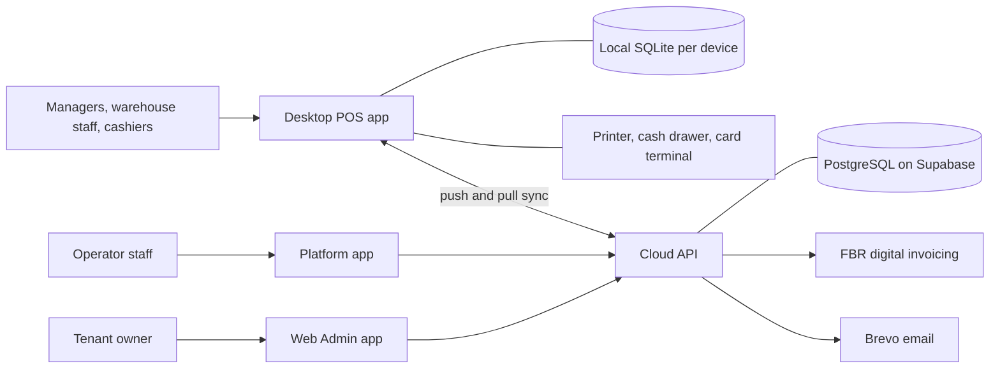
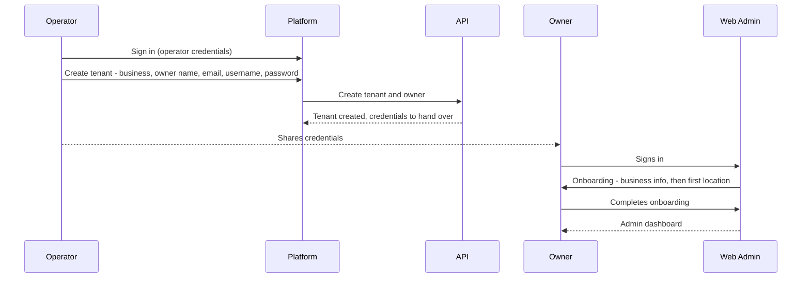
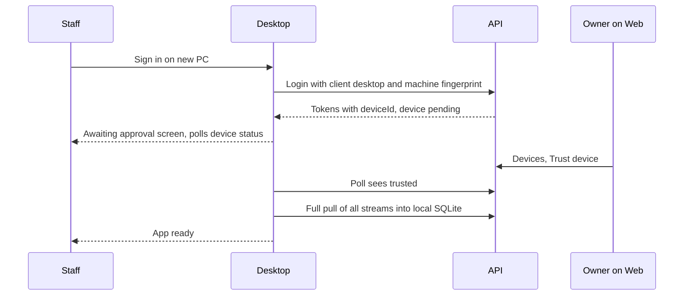
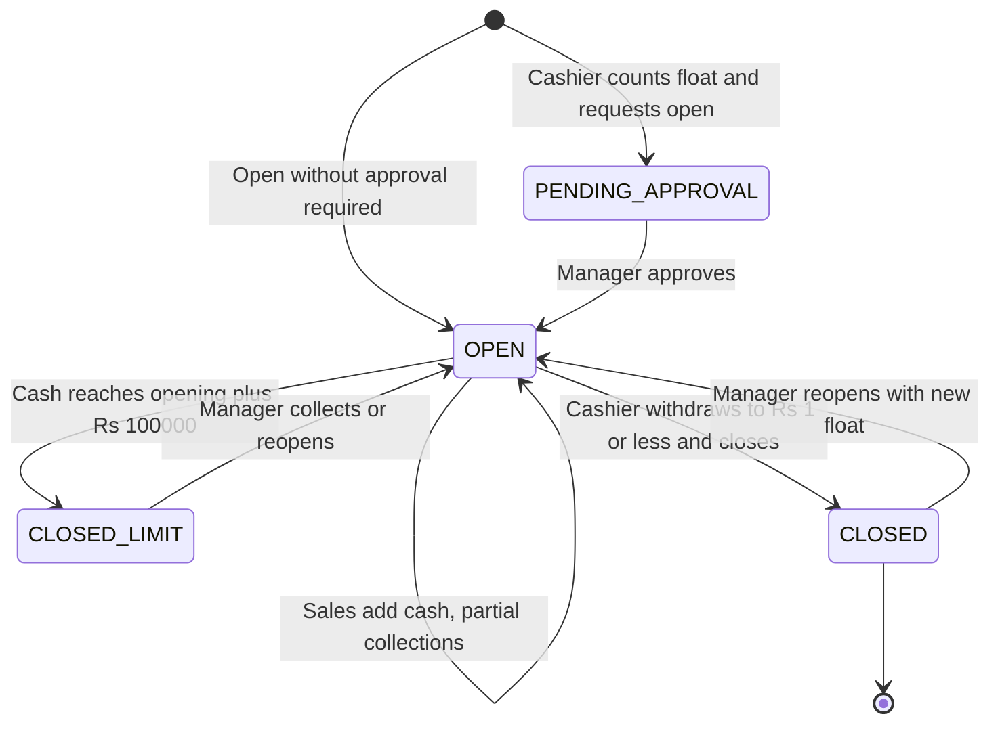
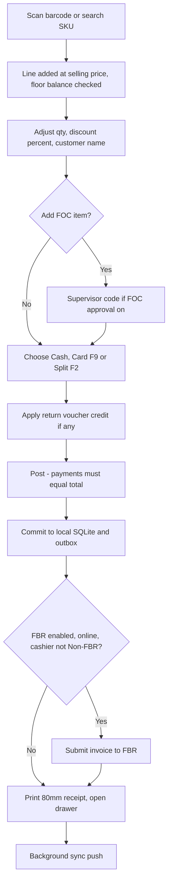
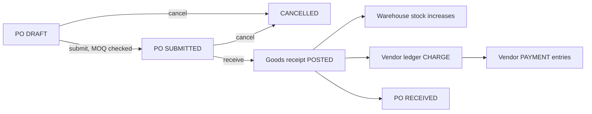

# Blackbox — Software Requirements Specification (SRS)

| | |
|---|---|
| **Product** | Blackbox retail management SaaS |
| **Document** | Software Requirements Specification |
| **Audience** | Product, QA, engineering, implementation and support teams |
| **Status** | Reflects the system as implemented in this repository (November 2026) |
| **Companion** | [product-guide.md](./product-guide.md) — plain-language walkthroughs and glossary |

---

## Contents

1. [Introduction](#1-introduction)
2. [Product overview](#2-product-overview)
3. [Actors and roles](#3-actors-and-roles)
4. [Module catalogue](#4-module-catalogue)
5. [How the system is used — end-to-end user flows](#5-how-the-system-is-used--end-to-end-user-flows)
6. [Functional requirements](#6-functional-requirements)
7. [Non-functional requirements](#7-non-functional-requirements)
8. [Data requirements — business entities](#8-data-requirements--business-entities)
9. [External interfaces](#9-external-interfaces)
10. [Out of scope and future items](#10-out-of-scope-and-future-items)
11. [Appendix](#11-appendix)

---

## 1. Introduction

### 1.1 Purpose

This document specifies **what Blackbox must do**: its modules, how each actor uses it, the
complete user flows, the functional and non-functional requirements, and the business data it
manages. It is the reference for acceptance testing, onboarding new engineers, and scoping
future work.

### 1.2 Scope

Blackbox is a multi-tenant SaaS for retail stores covering point of sale (POS), inventory,
purchasing, vendor accounts, cash control, Pakistan FBR digital invoicing, tax reporting, user
and device administration, and offline-first synchronisation between in-store desktops and the
cloud.

### 1.3 Conventions

| Convention | Meaning |
|------------|---------|
| `FR-<MODULE>-NN` | Functional requirement |
| `NFR-<AREA>-NN` | Non-functional requirement |
| **Must / Should / Could** | Priority (MoSCoW). All Must items are implemented unless marked Planned. |
| **Planned** | Specified but not yet implemented |
| `perm.key` | A permission key from `packages/shared/src/permissions.ts` |
| "The system shall…" | Normative statement; each is individually testable |

### 1.4 Definitions

See the glossary in [product-guide.md](./product-guide.md#2-glossary). Additional terms:

| Term | Definition |
|------|------------|
| **Floor balance** | Quantity of a SKU moved from a warehouse to the POS floor and still available to sell (`inventory_out_items`). |
| **Warehouse stock** | Quantity held in a warehouse (`inventory_stock`), excluding floor balance. |
| **Outbox** | Local SQLite queue of changes waiting to be pushed to the cloud. |
| **Stream** | A sync channel: `master_data`, `inventory`, `purchasing`, `auth_snapshot`. |
| **Cloud-hub device** | Per-tenant virtual device used as the origin for changes written through the REST API (for example, from Web Admin). |
| **Supervisor code** | 6-digit TOTP from a manager's authenticator app, used to approve sensitive POS actions. |
| **Device code** | Short code per device, embedded in document numbers so offline devices never collide. |

### 1.5 References

[architecture.md](./architecture.md), [auth-api.md](./auth-api.md),
[admin-api.md](./admin-api.md), [web-admin.md](./web-admin.md), [sync.md](./sync.md),
[inventory-api.md](./inventory-api.md), [sales-api.md](./sales-api.md),
[tax-reports.md](./tax-reports.md), [pos-card-terminal.md](./pos-card-terminal.md),
[import-templates/](./import-templates/).

---

## 2. Product overview

### 2.1 SaaS model

One **operator** (the Blackbox company) runs a single cloud deployment that serves many
**tenants** (client businesses). Each tenant has its own users, devices, master data and
transactions, fully isolated from other tenants. A single **global role catalogue** is shared
by all tenants.

### 2.2 System context

### 2.3 Applications

| App | Package | Technology | Users | Runs on |
|-----|---------|------------|-------|---------|
| API | `@blackbox/api` | NestJS 11, TypeORM, PostgreSQL | All apps | Cloud server, port 4000 |
| Web Admin | `@blackbox/web` | Next.js 15, React 19 | Owner | Browser |
| Platform | `@blackbox/platform` | Next.js | Operator | Browser (internal) |
| Desktop POS | `@blackbox/desktop` | Electron 36, React, SQLite | Owner, Manager, Warehouse Manager, Cashier | Windows, Linux |

Shared packages: `@blackbox/ui` (design system), `@blackbox/shared` (permissions, roles, DTOs,
business formulas, validation).

### 2.4 Operating environment

- Desktop: Windows and Linux PCs, an 80 mm ESC/POS thermal printer, a cash drawer, and an optional bank EDC card terminal (USB or serial).
- Browsers: current Chromium, Firefox and Safari.
- Database: Supabase-hosted PostgreSQL.
- Locale: Pakistan. Currency is PKR ("Rs"), business time is UTC+5, and calendar-day reports use business time.

### 2.5 Design constraints and assumptions

| ID | Constraint |
|----|------------|
| C-01 | Tenant isolation is enforced in the application layer from the JWT tenant. PostgreSQL row-level security is not used. |
| C-02 | Authentication is a custom JWT service (Argon2 passwords). No third-party identity provider. |
| C-03 | The schema changes only through SQL files in `supabase/migrations/`. The ORM never alters the schema. |
| C-04 | Authorisation uses permission keys, never role names. |
| C-05 | The cloud is the only sync hub. Devices never sync peer-to-peer. |
| C-06 | Request validation uses class-validator DTOs, with shared regex helpers in `@blackbox/shared`. |

---

## 3. Actors and roles

### 3.1 Actors

| Actor | Description | Apps |
|-------|-------------|------|
| **Operator** | Blackbox staff who provision and support tenants | Platform |
| **Owner** | Tenant administrator, responsible for settings, staff, devices and reports | Web Admin, Desktop |
| **Manager** | Supervises the counter: tills, voids, returns, cash flow | Desktop |
| **Warehouse Manager** | Products, stock movement, purchasing, vendors | Desktop |
| **Cashier** | Rings up sales, completes refunds, runs own till | Desktop |
| **Cashier (Non-FBR)** | Cashier whose bills are simple bills not sent to FBR | Desktop |
| **System** | Background jobs: sync, auto-update, FBR submission | All |
| **External** | FBR, Brevo email, bank card terminal | — |

### 3.2 Default role permission matrix

Source: `packages/shared/src/seeds.ts`. Roles are global and editable by the operator
(Platform) and by tenants with `roles.write`.

| Permission | Owner | Manager | Warehouse Mgr | Cashier | Cashier Non-FBR |
|------------|:-----:|:-------:|:-------------:|:-------:|:---------------:|
| `web.access` | ✔ | | | | |
| `desktop.access` | ✔ | ✔ | ✔ | ✔ | ✔ |
| `sync.use` | ✔ | ✔ | ✔ | ✔ | ✔ |
| `tenant.settings.read` / `.write` | ✔ | | | | |
| `users.read` / `.write` / `.deactivate` | ✔ | | | | |
| `roles.read` / `.write`, `permissions.read` | ✔ | | | | |
| `devices.read` / `.manage` | ✔ | | | | |
| `warehouses.read` / `.write` | ✔ | | ✔ | | |
| `inventory.access` | ✔ | | ✔ | | |
| `inventory.opening.write` | ✔ | | | | |
| `purchasing.access`, `vendors.access` | ✔ | | ✔ | | |
| `sales.read` | ✔ | ✔ | | | |
| `sales.write` | | | | ✔ | ✔ |
| `sales.non_fbr` | | | | | ✔ |
| `sales.void`, `sales.return` | ✔ | ✔ | | | |
| `sales.refund` | ✔ | | | ✔ | ✔ |
| `till.read` | ✔ | ✔ | | ✔ | ✔ |
| `till.manage` | ✔ | ✔ | | | |
| `activity.read`, `tax.reports.read` | ✔ | ✔ | | | |

Note: the owner deliberately lacks `sales.write`, which separates administration from cash
handling.

---

## 4. Module catalogue

| Code | Module | API | Web | Desktop | Primary actor | Key permissions |
|------|--------|:---:|:---:|:-------:|---------------|-----------------|
| AUTH | Authentication and sessions | ✔ | ✔ | ✔ | All | — |
| TEN | Tenants and business profile | ✔ | ✔ | | Owner | `tenant.settings.*` |
| ONB | Onboarding | ✔ | ✔ | | Owner | `tenant.settings.write` |
| SET | Tenant settings (tax, FBR, approvals) | ✔ | ✔ | | Owner | `tenant.settings.*` |
| PLT | Platform (operator console) | ✔ | Platform | | Operator | Operator JWT |
| USR | Users | ✔ | ✔ | | Owner | `users.*` |
| RBAC | Roles and permissions | ✔ | ✔ | | Owner, Operator | `roles.*`, `permissions.read` |
| DEV | Devices | ✔ | ✔ | ✔ | Owner | `devices.*`, `desktop.access` |
| SYNC | Offline sync | ✔ | | ✔ | System | `sync.use` |
| TILL | Cashier tills | ✔ | | ✔ | Cashier, Manager | `till.*` |
| SALE | POS sales | ✔ | | ✔ | Cashier, Manager | `sales.*` |
| HOLD | Held bills | | | ✔ | Cashier | `sales.write` |
| RET | Sale returns and refunds | ✔ | | ✔ | Manager, Cashier | `sales.return`, `sales.refund` |
| CASH | Cash flow and drawers | ✔ | | ✔ | Manager, Owner | `till.manage` |
| FBR | FBR digital invoicing | ✔ | ✔ (settings) | ✔ | System | `sales.write` |
| TAX | Tax reports | ✔ | ✔ | ✔ | Owner, Manager | `tax.reports.read` |
| TXN | Taxonomy (brands, categories, units, vendor groups) | ✔ | | ✔ | Warehouse Mgr | `inventory.access`, `vendors.access` |
| PRD | Products and SKUs | ✔ | | ✔ | Warehouse Mgr | `inventory.access` |
| WH | Warehouses and stock | ✔ | ✔ | ✔ | Owner, Warehouse Mgr | `warehouses.*` |
| VEN | Vendors, vendor SKUs, ledger, payments | ✔ | | ✔ | Warehouse Mgr | `vendors.access` |
| PO | Purchase orders | ✔ | | ✔ | Warehouse Mgr | `purchasing.access` |
| GRN | Goods receipts (purchase vouchers) | ✔ | | ✔ | Warehouse Mgr | `purchasing.access` |
| IO | Inventory out (warehouse to floor) | ✔ | | ✔ | Warehouse Mgr | `inventory.access` |
| IOR | Inventory out returns (floor to warehouse) | ✔ | | ✔ | Warehouse Mgr | `inventory.access` |
| VRT | Vendor returns | ✔ | | ✔ | Warehouse Mgr | `purchasing.access` |
| RPT | Dashboard and inventory reports | ✔ | ✔ | ✔ | Owner, Warehouse Mgr | `inventory.access` |
| ACT | Activity log | ✔ | ✔ | ✔ | Owner, Manager | `activity.read` |
| IMP | Master-data CSV import | ✔ | | ✔ | Owner, Warehouse Mgr | `inventory.access` |
| HW | POS hardware (printer, drawer, EDC) | | | ✔ | Cashier | — |

---

## 5. How the system is used — end-to-end user flows

Each flow lists its **trigger**, **steps**, **outcome** and **exceptions**.

### UF-01 Operator provisions a tenant

- **Exceptions:**
  - Duplicate active email: rejected.
  - Operator deactivates the tenant: all its users fail sign-in.
  - Owner forgets the password: the operator resets it, or the owner uses UF-14.

### UF-02 Owner self-signup

1. The owner opens Web Admin and chooses to create a business.
2. They enter the business name, full name, email, username and password.
3. The system creates, in one transaction: the tenant, role links, the owner user, and the cloud-hub device.
4. The owner completes onboarding:
   - Welcome.
   - Business: name, type, currency.
   - Location: name, address, city, country, phone.
5. The owner lands on `/app`.

- **Exceptions:** an email already used by an active account returns 409. A duplicate username in the same tenant returns 409.

### UF-03 Staff onboarding

1. Owner → Users → Add user: full name, email and/or username, initial password.
2. Owner assigns one or more roles.
3. The staff member signs in on Desktop with their username or email.

- **Exceptions:**
  - Deactivated user: 403 "deactivated by an administrator".
  - Deleted user: hidden from lists, but can be restored.

### UF-04 New desktop device

- **Exceptions:**
  - The user lacks `desktop.access`: 403.
  - The user already has a session on another PC: 409 "already signed in on another device".
  - Re-login on the same PC reuses the device row.

### UF-05 Till lifecycle

1. The cashier enters note counts (Rs 10, 20, 50, 100, 500, 1000, 5000). The opening balance must equal the counted total.
2. If the tenant requires till-open approval, a manager enters a supervisor code. The float is funded from that manager's drawer, and must not exceed the drawer balance.
3. Each cash sale adds to the till balance. At opening + Rs 90,000 a warning is shown. At opening + Rs 100,000 the till moves to `CLOSED_LIMIT` and further sales are blocked.
4. The manager collects cash, either partially by amount or fully, which credits the manager drawer.
5. At shift end, the cashier withdraws cash (withdrawal approval is optional) until the balance is Rs 1 or less, then closes.

- **Exceptions:** sign-out is blocked while the till is `OPEN`, `PENDING_APPROVAL` or `CLOSED_LIMIT`.

### UF-06 Sale checkout

- **Variants:**
  - **Hold:** the cashier parks the bill, which reserves floor qty on this device only. It can be resumed or discarded later.
  - **Remove line:** may require a supervisor code.
  - **Void:** a manager voids a posted bill, and the floor balance is restored.
- **Exceptions:**
  - Quantity exceeds the floor balance.
  - The till is not open or is at its limit.
  - Payment mismatch.
  - FBR failure: the sale stays posted, with FBR status `failed` and the error stored.

### UF-07 Customer return and refund

1. The manager searches the original bill and selects the returnable quantities. Paid quantity only; FOC is not returnable.
2. The system creates a `PENDING` sale return (voucher `{initials}-SR-…`) and restores the floor balance immediately.
3. The cashier completes the voucher in one of two ways:
   - **Standalone cash refund** from the till (`STANDALONE_CASH`). The till must hold enough cash.
   - **Sale offset** (`SALE_OFFSET`): credit is applied to a new sale and deducted from its amount due.
4. The return becomes `COMPLETED`.

### UF-08 Purchasing cycle

1. Create a PO for a vendor and warehouse. Lines come from that vendor's SKUs, entered by box or piece.
2. Submit it. Minimum order quantities are enforced.
3. Receive: enter the received and bonus quantities per line, plus voucher-level discount, taxes (sale tax, advance tax, GST), incentive, shelf rent, other charges and return credit.
4. Post. The system creates a purchase voucher (`{initials}-PV-…`), stock movements and stock, and a vendor ledger charge, and marks the PO received.
5. Record vendor payments against the ledger.

### UF-09 Stock to floor and back

1. **Inventory Out:** scan SKUs, then confirm. Warehouse stock decreases and floor balance increases (`{initials}-IO-…`).
2. **Out Return:** return unsold floor qty, up to the current floor balance. Floor balance decreases and warehouse stock increases (`{initials}-IR-…`).
3. **Vendor Return:** return goods to the vendor (`{initials}-VR-…`). Status is `OPEN` until every line is settled by `CASHBACK` or `REPLACE`, then `SETTLED`.

### UF-10 Cash flow day end

1. Managers record expenses (Rent, Electricity, Internet, Other) and bank deposits from their drawer. An expense cannot exceed the drawer balance.
2. The owner records manager drawer openings (cash given to a manager).
3. Managers submit drawer cash to the owner at day end.
4. The owner records owner cash entries and sees the running owner cash balance.
5. The report shows, per period: cashier cash sales, refunds and net cash; collections; expenses; and each manager's drawer balance.

Manager drawer balance = opening float + collected − expenses − till floats − submitted.

### UF-11 Offline operation

1. Connectivity drops. The desktop switches to offline mode and continues using local SQLite.
2. Sales, holds, till events and stock documents are committed locally and queued in the outbox. FBR submission is skipped for sales posted offline.
3. On reconnect, auto-sync pushes the outbox by stream, checks status, and pulls only lagging streams. Retries back off up to 5 minutes.
4. Conflicts are recorded and acknowledged. The last writer wins by entity version.

### UF-12 Device revoke and wipe

1. The owner revokes a device. Its refresh tokens are revoked and the device is flagged `wipe_local_data`.
2. On next contact the desktop erases its local database, acknowledges the wipe, and returns to sign-in.

### UF-13 Master-data import

1. Dashboard → Upload Old Data. Select one template CSV (10 MB maximum).
2. Upload in order: units → brands → categories → warehouses → vendor groups → products → SKUs → vendors and contacts → vendor-SKU pricing.
3. The upload is validated as a whole. Any error rolls back the entire file and reports the file, line, column and message.
4. On success, rows are upserted by stable key, and the desktop syncs the imported entity types.

### UF-14 Owner forgot password

1. The owner enters their email on the Web sign-in page. The system always returns a generic success message.
2. If exactly one eligible active owner matches, a 6-digit code is emailed. It is valid for 10 minutes, with at most 3 requests per hour.
3. The owner enters the code and a new password (minimum 8 characters). All of the owner's sessions are revoked.

---

## 6. Functional requirements

Each requirement is testable. Priority is Must (M), Should (S) or Could (C).

### 6.1 Authentication and sessions (AUTH)

| ID | Pri | Requirement |
|----|:---:|-------------|
| FR-AUTH-01 | M | The system shall authenticate users by email-or-username plus password, with no tenant supplied by the client. |
| FR-AUTH-02 | M | The system shall store passwords only as Argon2 hashes and never return or log them. |
| FR-AUTH-03 | M | The system shall issue a 15-minute access JWT with claims `sub` and `tenantId` (plus `deviceId` for desktop) and a 7-day refresh token stored only as a SHA-256 hash. |
| FR-AUTH-04 | M | The system shall return a generic `401 Invalid credentials` when the identifier matches zero or more than one active user, or when the password is wrong, so account existence is not revealed. |
| FR-AUTH-05 | M | The system shall return `403` with a deactivation message when the password is correct but the user is inactive, and reject login on an inactive tenant. |
| FR-AUTH-06 | M | The system shall rotate the refresh token atomically on refresh, revoking the old token and linking it via `replaced_by`. |
| FR-AUTH-07 | M | The system shall make logout idempotent, always clearing the local session even if the revoke call fails. |
| FR-AUTH-08 | M | The system shall derive tenant context for every protected route from the validated JWT and never from the request body or query. |
| FR-AUTH-09 | M | The system shall reject desktop login for users without `desktop.access` with `403`. |
| FR-AUTH-10 | M | The system shall allow only one active desktop session per user, returning `409` if a non-revoked session exists on a different device, while allowing re-login on the same device to revoke the previous one. |
| FR-AUTH-11 | S | The system shall provide owner self-service password reset by emailed 6-digit OTP (10-minute TTL, at most 3 requests per user per hour), always returning a generic response, and shall revoke all of that user's refresh tokens on success. |

### 6.2 Tenants, onboarding and settings (TEN, ONB, SET)

| ID | Pri | Requirement |
|----|:---:|-------------|
| FR-TEN-01 | M | The system shall create, in one transaction at signup, the tenant, its role links, the owner user and a cloud-hub device. |
| FR-TEN-02 | M | The system shall keep each tenant's data isolated so no request can read or write another tenant's rows. |
| FR-ONB-01 | M | The system shall capture business information (name, type, currency) and a first location (name, address, city, country, phone) during onboarding and record `onboardingCompletedAt`. |
| FR-ONB-02 | S | The system shall use the onboarding location address as the printed receipt header. |
| FR-SET-01 | M | The system shall let `tenant.settings.write` holders set the default GST rate and sales-tax rate. |
| FR-SET-02 | M | The system shall let the owner enable or disable FBR and configure environment (sandbox/production), seller NTN, province, address, security token and sandbox scenario. |
| FR-SET-03 | M | The system shall let the owner toggle manager-approval requirements independently for: removing a sale line, opening a till, withdrawing from a till, and giving FOC. |
| FR-SET-04 | M | The system shall expose settings read behind `tenant.settings.read` and writes behind `tenant.settings.write`. |

### 6.3 Platform / operator console (PLT)

| ID | Pri | Requirement |
|----|:---:|-------------|
| FR-PLT-01 | M | The system shall authenticate operators through a separate platform login distinct from tenant users. |
| FR-PLT-02 | M | The system shall let operators list all tenants and create a tenant together with its owner credentials. |
| FR-PLT-03 | M | The system shall let operators activate or deactivate a tenant and reset a tenant owner's password. |
| FR-PLT-04 | M | The system shall let operators view and edit the global role catalogue and each role's permissions, applying to all tenants. |

### 6.4 Users, roles and permissions (USR, RBAC)

| ID | Pri | Requirement |
|----|:---:|-------------|
| FR-USR-01 | M | The system shall let `users.write` holders create and update users and set an initial password. |
| FR-USR-02 | M | The system shall let `users.deactivate` holders deactivate or reactivate a user; deactivated users cannot sign in but retain history. |
| FR-USR-03 | S | The system shall support soft delete and restore of users, hiding deleted users from lists. |
| FR-USR-04 | M | The system shall assign permissions only through roles (`user_roles` → `role_permissions`), never directly to a user. |
| FR-RBAC-01 | M | The system shall evaluate `@RequirePermissions` with AND semantics, always scoped by the JWT tenant. |
| FR-RBAC-02 | M | The system shall enforce authorization in the API `PermissionsGuard`; frontend permission checks are for UX only. |
| FR-RBAC-03 | M | The system shall let `roles.write` holders edit role permissions and expose the full permission catalogue behind `permissions.read`. |

### 6.5 Devices and sync (DEV, SYNC)

| ID | Pri | Requirement |
|----|:---:|-------------|
| FR-DEV-01 | M | The system shall register a new desktop device as `pending`, identified by `(tenant_id, fingerprint)`, and allow it to read its own status and sync status but not push or pull. |
| FR-DEV-02 | M | The system shall let `devices.manage` holders trust a device, which enables `/sync/*`. |
| FR-DEV-03 | M | The system shall revoke a device's refresh tokens when it is revoked, signing it out on its next request. |
| FR-DEV-04 | M | The system shall flag a revoked device `wipe_local_data`, and the desktop shall erase its local database and acknowledge before syncing again. |
| FR-DEV-05 | S | The system shall derive the desktop fingerprint from the OS machine id so reinstalling on the same machine reuses the device row. |
| FR-SYNC-01 | M | The system shall exchange changes only with trusted devices whose user holds `sync.use`, over four streams: `master_data`, `inventory`, `purchasing`, `auth_snapshot` (Planned). |
| FR-SYNC-02 | M | The system shall never drop queued outbox changes, retaining them through outages and retrying with backoff up to 5 minutes. |
| FR-SYNC-03 | M | The system shall exclude a device's own changes from its pull, and advance its cursor without transferring payloads when only its own changes are ahead. |
| FR-SYNC-04 | M | The system shall resolve master-data conflicts by last-writer-wins on `entity_version` and record unresolved conflicts for acknowledgement. |
| FR-SYNC-05 | M | The system shall treat `SALE` and `SALE_RETURN` movements as audit-only, with floor balance adjusted by sale and sale-return entity upserts. |
| FR-SYNC-06 | M | The system shall commit the pull cursor advance in the same local transaction as applying the change. |

### 6.6 Tills (TILL)

| ID | Pri | Requirement |
|----|:---:|-------------|
| FR-TILL-01 | M | The system shall require the opening balance to equal the counted note denominations (Rs 10 to Rs 5000). |
| FR-TILL-02 | M | The system shall require a supervisor code to open a till when the tenant requires till-open approval, and fund the float from the approving manager's drawer without exceeding its balance. |
| FR-TILL-03 | M | The system shall warn at opening + Rs 90,000 and move the till to `CLOSED_LIMIT`, blocking sales, when cash reaches opening + Rs 100,000. |
| FR-TILL-04 | M | The system shall let `till.manage` holders collect cash (partial by amount or full), crediting the manager drawer, and reopen a till with a new float. |
| FR-TILL-05 | M | The system shall require the till balance to be Rs 1 or less before a cashier may close it voluntarily, and optionally require a supervisor code to withdraw. |
| FR-TILL-06 | M | The system shall block a cashier from signing out while their till is `OPEN`, `PENDING_APPROVAL` or `CLOSED_LIMIT`. |
| FR-TILL-07 | M | The system shall expose a cashier's own till behind `till.read`. |

### 6.7 Sales, held bills, returns and refunds (SALE, HOLD, RET)

| ID | Pri | Requirement |
|----|:---:|-------------|
| FR-SALE-01 | M | The system shall let `sales.write` holders post a sale in one transaction, writing `sales`, `sale_lines`, `sale_payments`, decrementing floor balance by quantity + FOC, and writing a `SALE` movement. |
| FR-SALE-02 | M | The system shall price lines at selling price with optional per-line discount, and apply header GST and sales tax. |
| FR-SALE-03 | M | The system shall require the sum of payments to equal the computed bill total. |
| FR-SALE-04 | M | The system shall support payment methods CASH, CARD and CREDIT, including split payments. |
| FR-SALE-05 | M | The system shall require each line to have quantity > 0 or FOC > 0, with quantity + FOC not exceeding the SKU's floor balance in the warehouse. |
| FR-SALE-06 | M | The system shall require a supervisor user when any line has FOC and the tenant's FOC approval flag is on, and shall treat FOC-only lines (quantity 0, line total 0) as non-returnable. |
| FR-SALE-07 | M | The system shall default a blank customer name to "CASH SALES CUSTOMER" and store `cashTendered` for the change line on the receipt. |
| FR-SALE-08 | M | The system shall allocate bill numbers as `{initials}[-{deviceCode}]-SB-##`. |
| FR-SALE-09 | M | The system shall let `sales.void` holders void a posted sale, restoring floor balance, and reject voiding an already-void sale. |
| FR-SALE-10 | M | The system shall apply any return-voucher credit against the amount due before computing payment. |
| FR-SALE-11 | S | The system shall optionally require a supervisor code to remove a sale line when the tenant requires it. |
| FR-HOLD-01 | M | The system shall let a cashier hold an in-progress bill locally on the device, reserving floor balance, without pushing it to the cloud. |
| FR-HOLD-02 | M | The system shall use hold numbers `{initials}[-{deviceCode}]-HOLD-##` and allocate a real bill number only on post. |
| FR-HOLD-03 | M | The system shall release the reservation when a held bill is discarded, and deduct stock only at post time. |
| FR-RET-01 | M | The system shall let `sales.return` holders issue a `PENDING` return voucher for paid quantities only, restoring floor balance immediately. |
| FR-RET-02 | M | The system shall let `sales.refund` holders complete a voucher as a standalone cash refund (requiring sufficient till cash) or as credit offset against a new sale. |
| FR-RET-03 | M | The system shall record issue and refund actors and timestamps and mark the return `COMPLETED` on completion. |
| FR-RET-04 | M | The system shall use return numbers `{initials}[-{deviceCode}]-SR-##` and exclude voided sales from tax reporting. |

### 6.8 FBR digital invoicing (FBR)

| ID | Pri | Requirement |
|----|:---:|-------------|
| FR-FBR-01 | M | The system shall submit a posted sale to FBR when the tenant has FBR enabled, the session is online, and the cashier is not Non-FBR. |
| FR-FBR-02 | M | The system shall mark bills posted by Non-FBR cashiers as `excluded` and never send them to FBR. |
| FR-FBR-03 | M | The system shall keep a sale posted on FBR failure, storing status `failed` and the error for later review. |
| FR-FBR-04 | M | The system shall snapshot each line's HS code onto the sale at submission and require HS codes in the FBR format. |
| FR-FBR-05 | M | The system shall track FBR invoice status as pending, submitted, failed or excluded, and record the FBR invoice number and seller NTN. |

### 6.9 Tax reports and activity log (TAX, ACT)

| ID | Pri | Requirement |
|----|:---:|-------------|
| FR-TAX-01 | M | The system shall report, for a date range, tax paid to vendors from posted goods receipts, broken down by vendor and by month, with incentive and shelf rent shown as credits. |
| FR-TAX-02 | M | The system shall report tax collected from customers (GST and sales tax) from posted sales, net of pending/completed returns, excluding voided sales. |
| FR-TAX-03 | S | The system shall allow filtering by vendor and tax kind and support CSV export, behind `tax.reports.read`. |
| FR-ACT-01 | M | The system shall record key events (sale posted, void, FOC, till open/close/limit, line quantity adjusted) with actor, optional supervisor, and timestamp. |
| FR-ACT-02 | M | The system shall expose the activity log behind `activity.read` on web and desktop. |

### 6.10 Taxonomy, products and warehouses (TXN, PRD, WH)

| ID | Pri | Requirement |
|----|:---:|-------------|
| FR-TXN-01 | M | The system shall manage brands, categories, units and vendor groups with active/inactive status, soft delete and restore, and default list views to active only. |
| FR-PRD-01 | M | The system shall require a brand and category to create a product and shall assign the product code server-side. |
| FR-PRD-02 | M | The system shall manage SKUs with barcode, HS code, cost and selling price, GST percent, units and packaging, reorder and stock levels, and status. |
| FR-PRD-03 | M | The system shall reject inactive brand or category references on product create/update. |
| FR-PRD-04 | M | The system shall store suppliers only via `vendor_skus`, never on products or SKUs. |
| FR-WH-01 | M | The system shall manage warehouses behind `warehouses.read`/`warehouses.write`. |
| FR-WH-02 | M | The system shall track warehouse stock as quantity on hand, reserved and available, separately from POS floor balance. |
| FR-WH-03 | S | The system shall let `inventory.opening.write` holders record opening warehouse quantities. |

### 6.11 Vendors and purchasing (VEN, PO, GRN, IO, IOR, VRT)

| ID | Pri | Requirement |
|----|:---:|-------------|
| FR-VEN-01 | M | The system shall manage vendors with typed contacts (primary, other, manager, salesperson) and payment terms (CASH, 7/15/30/45 days, custom). |
| FR-VEN-02 | M | The system shall link vendor SKUs with purchase price, packaging and minimum order quantity, defaulting packaging from the product SKU. |
| FR-VEN-03 | M | The system shall maintain a vendor ledger of CHARGE entries from goods receipts and PAYMENT entries, exposing the running balance and payments. |
| FR-PO-01 | M | The system shall create POs as DRAFT (or submitted), assign a PO number, and recalculate line and header totals, without changing inventory. |
| FR-PO-02 | M | The system shall enforce minimum order quantities on submit and allow cancel from DRAFT or SUBMITTED. |
| FR-PO-03 | M | The system shall store quantities and costs in purchase units regardless of whether the line was entered by box or piece. |
| FR-PO-04 | S | The system shall reject a submitted-line price update where unit cost is greater than or equal to selling price. |
| FR-GRN-01 | M | The system shall receive against a submitted PO in one transaction: create a POSTED receipt and items, write `PURCHASE_RECEIPT` movements, increase stock, and set the PO to RECEIVED. |
| FR-GRN-02 | M | The system shall allow at most one posted receipt per PO, with received quantity between 0 and ordered quantity, and never mutate historical PO unit cost. |
| FR-GRN-03 | M | The system shall capture voucher-level discount, taxes, incentive, shelf rent, other charges and return credit, and record `amount_paid` and a vendor ledger charge. |
| FR-IO-01 | M | The system shall move stock to the floor atomically: POSTED out document, `INVENTORY_OUT` movements, warehouse stock decrease and floor balance increase, with quantity within available stock. |
| FR-IOR-01 | M | The system shall return floor stock to the warehouse up to the current floor balance, with the reverse movements and balances. |
| FR-VRT-01 | M | The system shall record vendor returns as `OPEN` and set `SETTLED` only when every line is settled by CASHBACK or REPLACE. |

### 6.12 Reports, import and hardware (RPT, IMP, HW)

| ID | Pri | Requirement |
|----|:---:|-------------|
| FR-RPT-01 | M | The system shall present dashboard counts (products, SKUs, stock lines, low-stock items, pending POs, recent receipts). |
| FR-RPT-02 | M | The system shall produce an inventory in/out report over a date range with inbound and outbound buckets and daily totals, exportable as CSV. |
| FR-IMP-01 | M | The system shall accept exactly one master-data CSV per request (10 MB maximum), reject ZIP and multi-file uploads, and validate before committing. |
| FR-IMP-02 | M | The system shall roll back the whole file on any row error and report the file, line, column and message. |
| FR-IMP-03 | M | The system shall upsert import rows by stable keys so repeat uploads update rather than duplicate, then sync the imported entity types to the desktop. |
| FR-HW-01 | M | The system shall print an 80 mm thermal receipt showing business name and address, customer, line items (name, qty, price, total), totals, cash and change when tendered, cashier name and non-cash payments, and open the cash drawer. |
| FR-HW-02 | S | The system shall optionally send the card portion of a bill to a bank EDC in USB keyboard mode on Card or Split, best-effort, without changing the sale payload. |
| FR-HW-03 | C | The system shall support serial/COM bank EDC amount frames per bank (Planned; keyboard mode or manual entry until then). |

---

## 7. Non-functional requirements

### 7.1 Security

| ID | Pri | Requirement |
|----|:---:|-------------|
| NFR-SEC-01 | M | Passwords shall be hashed with Argon2; refresh tokens shall be stored only as SHA-256 hashes; access tokens shall never be stored server-side. |
| NFR-SEC-02 | M | Access tokens shall live 15 minutes and be renewed via refresh rotation for up to 7 days; tokens shall never appear in URLs, UI or logs. |
| NFR-SEC-03 | M | Only trusted devices may sync; sensitive POS actions shall be gated by manager TOTP codes per tenant settings. |
| NFR-SEC-04 | M | Sync and offline authorization shall be bound to a device via `device_users` and the `deviceId` JWT claim. |
| NFR-SEC-05 | S | The web session trade-off (refresh token in `localStorage`) is a conscious Phase 1 choice; an httpOnly-cookie BFF is a future hardening step. |

### 7.2 Privacy and tenant isolation

| ID | Pri | Requirement |
|----|:---:|-------------|
| NFR-PRIV-01 | M | Every tenant-scoped query shall filter by the JWT tenant; a client-supplied tenant id shall never authorize access. |
| NFR-PRIV-02 | M | Composite foreign keys shall prevent cross-tenant relationships at the database layer. |

### 7.3 Reliability and offline behaviour

| ID | Pri | Requirement |
|----|:---:|-------------|
| NFR-REL-01 | M | The desktop shall remain fully usable for selling, tills, returns and stock while offline. |
| NFR-REL-02 | M | Outbox changes shall survive restarts and outages and never be lost. |
| NFR-REL-03 | M | Each posting operation (sale, receipt, inventory out, return, void) shall be atomic, leaving no partial records. |
| NFR-REL-04 | M | Auto-sync shall retry with exponential backoff capped at 5 minutes and run only for trusted sessions. |

### 7.4 Performance

| ID | Pri | Requirement |
|----|:---:|-------------|
| NFR-PERF-01 | M | Counter operations (barcode lookup, add to cart, post) shall read and write the local database so they do not wait on the network. |
| NFR-PERF-02 | S | Sync push shall batch at most 100 changes per request and pull only streams with lag. |
| NFR-PERF-03 | S | List pages shall be paginated. |

### 7.5 Usability

| ID | Pri | Requirement |
|----|:---:|-------------|
| NFR-USE-01 | M | The desktop shall provide keyboard shortcuts for primary actions (for example Alt+S to open a sale, F9 Card, F2 Split, F10 Add FOC). |
| NFR-USE-02 | M | Forms shall show inline, field-level validation with `aria-invalid`. |
| NFR-USE-03 | M | Navigation shall show only modules permitted for the signed-in user. |
| NFR-USE-04 | S | Local-first desktop pages shall indicate whether they show local or API data. |

### 7.6 Maintainability and portability

| ID | Pri | Requirement |
|----|:---:|-------------|
| NFR-MNT-01 | M | The schema shall change only through `supabase/migrations/`; the ORM shall run with `synchronize: false`. |
| NFR-MNT-02 | M | Shared business rules, permissions and validation shall live once in `@blackbox/shared`; shared UI only in `@blackbox/ui`. |
| NFR-PORT-01 | M | The desktop shall run on Windows and Linux; web apps shall run in current mainstream browsers. |
| NFR-PORT-02 | S | Desktop installers shall be produced by CI, and the desktop shall self-update silently. |

### 7.7 Localisation and auditability

| ID | Pri | Requirement |
|----|:---:|-------------|
| NFR-LOC-01 | M | Money shall be in PKR and stored to 4 decimal places; calendar-day reporting shall use business time (UTC+5). |
| NFR-LOC-02 | M | Till denominations shall be Rs 10, 20, 50, 100, 500, 1000 and 5000. |
| NFR-AUD-01 | M | Key actions shall be recorded in the activity log with actor and timestamp; deleted master data shall be soft-deleted and retained for history. |

---

## 8. Data requirements — business entities

Entities are defined in `apps/api/src/db/entities/`. Every tenant-scoped row carries
`tenant_id`. Money is `numeric(14,4)`. "Live" lists exclude rows with a `deleted_at` value.

### 8.1 Entity relationship overview

```mermaid
erDiagram
    TENANT ||--o{ USER : has
    TENANT ||--o{ ROLE_PERMISSION : grants
    TENANT ||--o{ DEVICE : registers
    TENANT ||--o{ LOCATION : has
    USER ||--o{ USER_ROLE : assigned
    ROLE ||--o{ USER_ROLE : in
    ROLE ||--o{ ROLE_PERMISSION : grantedBy
    PERMISSION ||--o{ ROLE_PERMISSION : listedIn
    USER ||--o{ REFRESH_TOKEN : holds
    DEVICE ||--o{ DEVICE_USER : authorizes
    USER ||--o{ DEVICE_USER : worksOn

    TENANT ||--o{ PRODUCT : owns
    BRAND ||--o{ PRODUCT : classifies
    CATEGORY ||--o{ PRODUCT : classifies
    PRODUCT ||--o{ PRODUCT_SKU : has
    PRODUCT_SKU ||--o{ PRODUCT_SKU_BARCODE : identifiedBy
    VENDOR_GROUP ||--o{ VENDOR : groups
    VENDOR ||--o{ VENDOR_CONTACT : has
    VENDOR ||--o{ VENDOR_SKU : supplies
    PRODUCT_SKU ||--o{ VENDOR_SKU : suppliedAs

    WAREHOUSE ||--o{ INVENTORY_STOCK : holds
    PRODUCT_SKU ||--o{ INVENTORY_STOCK : stockedAs
    WAREHOUSE ||--o{ INVENTORY_OUT_ITEM : floorBalance
    PRODUCT_SKU ||--o{ INVENTORY_MOVEMENT : moves

    VENDOR ||--o{ PURCHASE_ORDER : receives
    PURCHASE_ORDER ||--o{ PURCHASE_ORDER_ITEM : contains
    PURCHASE_ORDER ||--o{ GOODS_RECEIPT : receivedBy
    GOODS_RECEIPT ||--o{ GOODS_RECEIPT_ITEM : contains
    VENDOR ||--o{ VENDOR_LEDGER_ENTRY : owes
    GOODS_RECEIPT ||--o{ VENDOR_LEDGER_ENTRY : charges
    VENDOR ||--o{ VENDOR_RETURN : returnedTo

    WAREHOUSE ||--o{ SALE : soldFrom
    SALE ||--o{ SALE_LINE : contains
    SALE ||--o{ SALE_PAYMENT : paidBy
    SALE ||--o{ SALE_RETURN : returnedBy
    SALE_RETURN ||--o{ SALE_RETURN_LINE : contains

    USER ||--o{ TILL_SESSION : operates
    TILL_SESSION ||--o{ TILL_WITHDRAWAL : records
    TENANT ||--o{ CASH_EXPENSE : logs
    TENANT ||--o{ MANAGER_DRAWER_OPENING : funds
    TENANT ||--o{ MANAGER_DRAWER_SUBMISSION : submits
    TENANT ||--o{ OWNER_CASH_ENTRY : records

    DEVICE ||--o{ SYNC_CURSOR : tracks
    TENANT ||--o{ SYNC_CHANGE : logs
    DEVICE ||--o{ SYNC_CONFLICT : raises
```

### 8.2 Identity and access

| Entity | Purpose | Key fields |
|--------|---------|-----------|
| `tenants` | One business; holds tax, FBR and approval settings | `name`, `isActive`, `currency`, `defaultGstRate`, `defaultSalesTaxRate`, `fbrEnabled`, `requireManagerApproval*`, `onboardingCompletedAt` |
| `locations` | Store addresses; first one prints on receipts | `name`, `city`, `address`, `phone` |
| `users` | Login identity | `email`, `username`, `fullName`, `passwordHash`, `isActive`, `deletedAt` |
| `roles` / `permissions` | Global role catalogue and permission keys | `roles.key`/`name`/`isSystem`; `permissions.key`/`description` |
| `role_permissions` / `user_roles` | Which permissions a role grants; which roles a user has | composite keys |
| `devices` | Registered machines and trust state | `fingerprint`, `code`, `status`, `trustedAt`, `revokedAt`, `needsFullResync`, `wipeLocalData` |
| `device_users` | Users authorized to work offline on a device | `offlineEnabled`, `offlineExpiresAt`, `lastOnlineAt` |
| `refresh_tokens` | Rotation chain of refresh tokens | `tokenHash`, `deviceId`, `expiresAt`, `revokedAt`, `replacedBy` |
| `user_totp` | Supervisor authenticator secret | `secretCiphertext`, `confirmedAt` |
| `password_reset_codes` | Hashed owner reset OTPs | `codeHash`, `expiresAt`, `usedAt` |

### 8.3 Master data

| Entity | Purpose | Key fields |
|--------|---------|-----------|
| `brands`, `categories`, `units`, `vendor_groups` | Reference data | `name`, `status`, `deletedAt` |
| `products` | Sellable item | `name`, `productCode`, `brandId`, `categoryId`, `productType`, `status` |
| `product_skus` | Sellable variant | `sku`, `barcode`, `hsCode`, `costPrice`, `sellingPrice`, `gstPercent`, `baseUnitId`, `purchaseUnitId`, `unitsPerPurchaseUnit`, `reorderLevel` |
| `product_sku_barcodes` | Extra barcodes with multiplier | `barcode`, `quantityMultiplier`, `status` |
| `vendors` | Supplier | `name`, `vendorCode`, `groupId`, `paymentTerms`, `creditLimit`, `taxNumber`, `status` |
| `vendor_contacts` | Vendor people | `contactType`, `name`, `phone`, `email` |
| `vendor_skus` | What a vendor supplies and at what price | `purchasePrice`, `purchaseUnitId`, `unitsPerPurchaseUnit`, `minimumOrderQuantity`, `isPreferred` |
| `warehouses` | Stock locations | `name`, `code`, `status` |

### 8.4 Purchasing and stock

| Entity | Purpose | Key fields |
|--------|---------|-----------|
| `purchase_orders` / `purchase_order_items` | Orders to vendors | PO: `poNumber`, `status`, totals; item: `quantity`, `unitCost`, `orderUnit`, `unitsPerPurchaseUnit` |
| `goods_receipts` / `goods_receipt_items` | Receipts against POs | GR: `receiptNumber`, `status`, taxes, `incentive`, `shelfRent`, `returnCredit`, `amountPaid`; item: `receivedQuantity`, `bonusQuantity`, taxes |
| `inventory_stock` | Warehouse stock per SKU | `quantityOnHand`, `quantityReserved`, `quantityAvailable` |
| `inventory_out` / `inventory_out_line` | Documents moving stock to the floor | `outNumber`, `status`, `quantity`, `unitCost` |
| `inventory_out_items` | Net POS floor balance per warehouse+SKU | `quantity`, `unitCost` |
| `inventory_out_returns` / items | Floor-to-warehouse returns | `returnNumber`, `quantity` |
| `vendor_returns` / items | Returns to vendors | `returnNumber`, `status`, item `settlement` (CASHBACK/REPLACE) |
| `vendor_ledger_entries` | Vendor balance | `entryType` (CHARGE/PAYMENT), `amount`, `goodsReceiptId` |
| `inventory_movements` | Audit of every stock change | `movementType`, `quantity`, `referenceType`, `referenceId` |

### 8.5 Sales and cash

| Entity | Purpose | Key fields |
|--------|---------|-----------|
| `sales` / `sale_lines` / `sale_payments` | POS bills | sale: `saleNumber`, `status`, `total`, `postedByName`, `cashTendered`, `fbrStatus`, `fbrInvoiceNumber`; line: `quantity`, `unitPrice`, `discountPercent`, `focQuantity`, `hsCode`; payment: `method`, `amount` |
| `sale_returns` / `sale_return_lines` | Customer returns | `returnNumber`, `status`, `refundTotal`, `refundMethod`, `completionMode`, `appliedToSaleId`, issue/refund actors |
| `till_sessions` / `till_withdrawals` | Cashier shifts | session: `status`, note counts, `openingBalance`, `currentCashBalance`, `maxCashLimit`, `fundedByUserId`; withdrawal: `withdrawalTotal`, `kind` |
| `cash_expenses` | Expenses and bank deposits | `category`, `amount`, `note`, `occurredAt` |
| `manager_drawer_openings` / `manager_drawer_submissions` | Owner funds a drawer / manager submits to owner | `managerUserId`, `amount` |
| `owner_cash_entries` | Running owner cash | `amount`, `note` |
| `activity_logs` | Audit trail | `eventType`, `actorUserId`, `supervisorUserId`, `summary`, `metadata` |

### 8.6 Sync

| Entity | Purpose | Key fields |
|--------|---------|-----------|
| `sync_changes` | Append-only change log per tenant | `seq`, `changeId`, `originDeviceId`, `stream`, `entityType`, `operation`, `entityVersion`, `payload` |
| `sync_cursors` | Committed cursor per device and stream | `deviceId`, `stream`, `cursor` |
| `sync_conflicts` | Recorded conflicts for review | `stream`, `entityType`, `localChangeId`, `cloudChangeId`, `reason`, `resolution` |

### 8.7 Status lifecycles

| Record | States |
|--------|--------|
| Purchase order | `DRAFT` → `SUBMITTED` → `RECEIVED`; `DRAFT`/`SUBMITTED` → `CANCELLED` (`PARTIALLY_RECEIVED` Planned) |
| Goods receipt | `POSTED` |
| Sale | `DRAFT` (held, local) → `POSTED` → `VOID` |
| Sale return | `PENDING` → `COMPLETED` |
| Till session | `PENDING_APPROVAL` / `OPEN` → `CLOSED_LIMIT` → `OPEN` → `CLOSED` |
| Device | `pending` → `trusted` → `revoked` |
| FBR invoice | `pending` → `submitted` / `failed` / `excluded` |
| Vendor return | `OPEN` → `SETTLED` |
| Master data | `active` / `inactive`, plus soft delete via `deleted_at` |

### 8.8 Document numbering

Numbers are built from the business initials, an optional per-device code, a type segment and a
padded sequence (see `packages/shared/src/document-numbers.ts`):

| Type | Pattern | Example |
|------|---------|---------|
| Vendor code | `{initials}[-{deviceCode}]-V##` | `AM-V01` |
| Purchase order | `{initials}[-{deviceCode}]-PO-##` | `AM-PO-07` |
| Purchase voucher (GRN) | `{initials}[-{deviceCode}]-PV-##` | `AM-PV-07` |
| Inventory out | `{initials}[-{deviceCode}]-IO-##` | `AM-IO-12` |
| Inventory out return | `{initials}[-{deviceCode}]-IR-##` | `AM-IR-03` |
| Sale bill | `{initials}[-{deviceCode}]-SB-##` | `AM-C1-SB-45` |
| Held bill | `{initials}[-{deviceCode}]-HOLD-##` | `AM-HOLD-02` |
| Sale return | `{initials}[-{deviceCode}]-SR-##` | `AM-SR-04` |
| Vendor return | `{initials}[-{deviceCode}]-VR-##` | `AM-VR-01` |

The device code keeps numbers unique when several offline devices allocate numbers at once.

---

## 9. External interfaces

| Interface | Direction | Notes |
|-----------|-----------|-------|
| FBR digital invoicing | API → FBR | Sandbox `postinvoicedata_sb` and production `postinvoicedata` endpoints; per-tenant environment, seller NTN, province, address, token and sandbox scenario. |
| Brevo email | API → Brevo | Owner password-reset OTP; falls back to console logging in development. |
| Thermal printer and cash drawer | Desktop → hardware | 80 mm ESC/POS receipt and drawer kick. |
| Bank EDC card terminal | Desktop → hardware | USB keyboard mode implemented; serial/COM per-bank frames Planned. Settings stored locally, not synced. |
| CSV import/export | User ↔ system | Master-data import templates in `docs/import-templates/`; report CSV exports. |

---

## 10. Out of scope and future items

| Item | Status |
|------|--------|
| PostgreSQL row-level security | Not used; app-layer isolation only. A future RLS design must target the Nest connection role. |
| Partial / multi-receive and `PARTIALLY_RECEIVED` | Planned; one posted receipt per PO today. |
| Serial/COM bank EDC amount frames per bank | Planned; keyboard mode or manual entry today. |
| `auth_snapshot` sync stream | Reserved; pull-only in a later phase. |
| httpOnly-cookie / BFF web session | Future hardening; Phase 1 keeps the refresh token in `localStorage`. |

---

## 11. Appendix

### 11.1 Permission catalogue

Source: `packages/shared/src/permissions.ts`.

| Key | Description |
|-----|-------------|
| `web.access` | Access the web admin application |
| `desktop.access` | Access the desktop application shell |
| `tenant.settings.read` / `.write` | View / update tenant settings |
| `users.read` / `.write` / `.deactivate` | List / create-update / deactivate users |
| `roles.read` / `.write` | List / edit roles and role permissions |
| `permissions.read` | View the permission catalogue |
| `devices.read` / `.manage` | List / trust, revoke and associate devices |
| `sync.use` | Push and pull incremental desktop sync |
| `warehouses.read` / `.write` | View / manage warehouses |
| `inventory.access` | Products, brands, stock movements, reports |
| `inventory.opening.write` | Record opening warehouse quantity |
| `purchasing.access` | Purchase orders and goods receipts |
| `vendors.access` | Vendors and vendor groups |
| `sales.read` | View bills and receipts |
| `sales.write` | Create and post sales |
| `sales.non_fbr` | Post simple bills not sent to FBR |
| `sales.void` | Void posted sales |
| `sales.return` | Process customer returns |
| `sales.refund` | Complete pending refunds at the till |
| `till.read` | View own till session |
| `till.manage` | Approve, withdraw and reopen tills |
| `activity.read` | View activity and approval log |
| `tax.reports.read` | View tax paid and collected reports |

### 11.2 Traceability (module to implementation)

| Module | API | Web | Desktop |
|--------|-----|-----|---------|
| AUTH | `auth/` | `/`, auth lib | login shell |
| TEN/SET/ONB | `tenants/` | `/onboarding`, `/app/settings` | — |
| PLT | `platform/` | Platform app | — |
| USR/RBAC | `users/`, `roles/`, `permissions/` | `/app/users`, `/app/roles`, `/app/permissions` | — |
| DEV | `devices/` | `/app/devices` | login / await-approval |
| SYNC | `sync/` | — | `src/main/db/*`, outbox |
| TILL | `tills/` | — | `/sales/till` |
| SALE/HOLD | `sales/` | — | `/sales/new`, `/sales/held`, `/sales` |
| RET | `sales/sale-returns/` | — | `/sales/returns*`, `/sales/refund-return` |
| CASH | `cash-flow/` | — | `/cash-flow` |
| FBR | `fbr/` | `/app/settings` | sale submit |
| TAX | `tax-reports/` | `/app/reports/taxes` | `/reports/taxes` |
| TXN/PRD | `inventory/brands|categories|units|products|skus` | — | `/brands`, `/categories`, `/products` |
| WH | `inventory/warehouses` | `/app/warehouses` | `/warehouses` |
| VEN | `inventory/vendors` | — | `/vendors`, `/vendor-groups` |
| PO/GRN | `inventory/purchase-orders|goods-receipts` | — | `/purchase-orders`, `/goods-receipts` |
| IO/IOR/VRT | `inventory/inventory-out*|vendor-returns` | — | `/inventory/out*`, `/inventory/returns` |
| RPT | `inventory/dashboard`, `inventory-reports` | `/app/inventory/reports` | `/`, `/inventory/reports` |
| ACT | `activity-log/` | `/app/activity` | `/activity` |
| IMP | `inventory/imports` | — | Dashboard Upload Old Data |
| HW | — | — | `src/main/pos/*` |

---

*End of document.*

